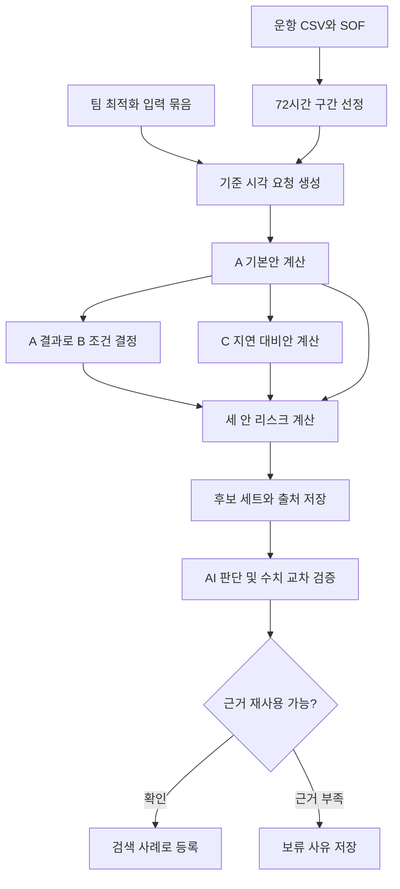
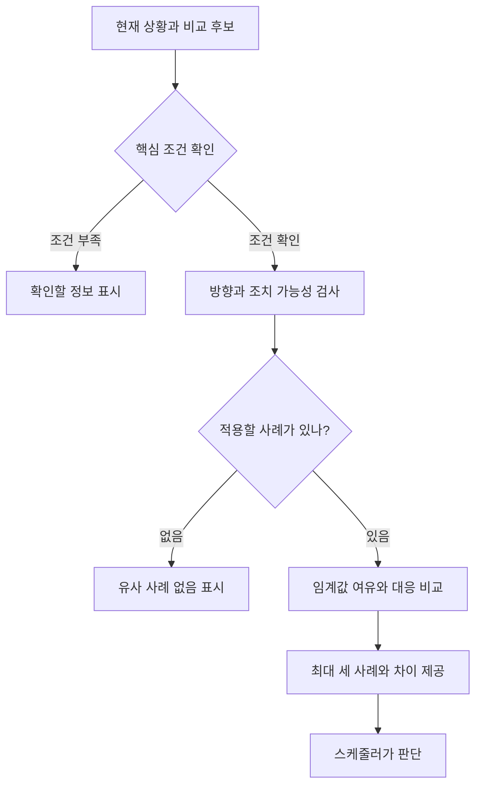

# 유사 사례 에이전트 데이터 정의와 파이프라인

D-MIN-prototype-palantir / [실행 로드맵](precedent-agent-roadmap.md)

목표는 스케줄러가 A·B·C를 비교할 때 판단을 바꾼 제약, 고려한 조치, 이번에 다시 확인할 조건을 찾는 것이다. 기존 솔버와 리스크 모델이 후보의 근거를 계산하고, Codex가 모의 판단과 그 검증 결과를 기록한다.

## 1. 자료별 용도

| 자료 | 확보한 정보와 사용 위치 | 상태 |
|---|---|---|
| sk_2025_demurrage.csv | 항차 단위 입항·접안·이안, 정박지 및 대기, 시각 정밀도, 일부 SOF 매칭. 72시간 재현 구간 선정과 사후 실적 대조에 사용한다. | 첫 구간 선정 완료. 해당 구간은 시간 단위이며 SOF 매칭 없음. |
| sk_voyages_tables.xlsx | 첨부 원본에서 voyages, sofs, voyage_sof, ambiguous 4개 시트를 확인했다. 항차와 SOF 대조, 매칭 불확실성 확인에 사용한다. | 첨부본에 berthings 시트가 없다. 복수 접안 회차를 정밀하게 재현하려면 접안 단위 원천이나 팀 묶음이 필요하다. |
| 팀의 11-26 연간 최적화 묶음 또는 real-2025.json | 기준 시각별 계획 대상 선박, 예상 도착, 고정·제한 조건, 하역 속도 사용 근거, 계약, 기상, 탱크·생산계획을 솔버 요청에 매핑한다. 프런트는 /prep/rates, /engine/plans, /risk/risks를 사용한다. | 11월 26일자 연간 묶음을 확보하고 변환했다. [입력 검증 근거](precedent-agent-pilot-2025-02-10.md) |
| 솔버·리스크 응답 | 후보별 배치, 예상 체선료, 완화·누락·미충족, 리스크 증거를 기록한다. | 합성 검증 사례 2건의 A·B·C와 리스크를 팀 코드로 계산해 저장했다. [검증 스냅숏](fixtures/precedent-agent-synthetic.json) |
| 판단 기록과 사후 결과 | 선택·보류·재계산, 경합안, 영향을 판단한 이유, 재검토 조건, 이후 실행 결과를 연결한다. | AI 모의 판단과 실제 기록을 출처로 구분한다. 자료가 없는 실행 결과는 미확인으로 둔다. |

## 2. 저장 단위와 최소 필드

기준 시각 T에 같은 공통 조건으로 계산한 후보 세 개를 하나의 **후보 세트**로 기록한다. 같은 세트에 최초 판정과 교차 검증 결과를 연결할 수 있다. 조건을 고쳐 다시 풀면 요청 버전을 올린다.

| 저장 단위 | 필수 필드 | 작성 주체 |
|---|---|---|
| 상황 스냅숏 | case_id, case_group_id, as_of, window_end, 출처 유형, 입력 해시, 기준 시각에 확인된 선박 상태·고정 조건, 탱크 경계 방향, 기상·부두 제약, 계약과 주요 값의 출처·정밀도 | 수집기 및 데이터 담당 |
| 후보 A/B/C | 화면 슬롯, 실제 실행 프리셋 및 파라미터, request_hash, schedule_id, 계산 상태, 선박별 선석·ETB·작업·ETU, 예상 체선료 센트, 누락·탱크 완화·긴급조건 미충족, 리스크 종류·등급·영향 대상·시간·근거 수치, 모델 버전 | 기존 솔버와 리스크 모델 |
| 판정 | 후보 세트 ID, 판단 출처와 검토 시각, 선택한 schedule_id 또는 보류·재계산, 경합안, 인용한 후보 필드·리스크 ID, 감수한 대가, 다시 검토할 조건, 남은 확인 사항 | Codex |
| 사후 확인 | 실행 여부, 실제 접안·하역, 지연·납기·재고 이탈, 확인 가능한 정산 결과, 관측 시각·출처 | 운영 자료 담당 |
| 검색용 특징 | 핵심 제약 및 상·하한 방향, 임계값 여유와 시간 압박, 변경 가능한 작업, 적용 가능한 대응, 시연 제외와 노출 가능 여부 | 스냅숏에서 계산, 검토자가 확인 |

- 출처 유형은 **합성 기술 검증**, **실적 기반 모의 판단**, **현업 검토를 마친 모의 판단**, **당시 의사결정 기록이 확인된 실제 사례**를 구분한다. 현재 합성 결과에는 사람 판단과 실제 실행 결과가 없다. 운영 사례 검색에서 제외한다.
- AI가 스케줄러 역할로 작성한 모의 판단에는 `ai_simulated_scheduler_review` 출처와 원본 스냅숏 해시를 기록한다. 개발용 조회에 쓰며, 실제 운영 판단이나 실행 결과는 근거가 확보된 경우 출처를 연결한다. [첫 수집 라운드](precedent-agent-round-01.md#모의-판단-데이터)
- 원본 요청과 응답은 스냅숏과 연결해 보존한다. 시각은 오프셋을 포함하고, 시간 단위 관제 기록은 분 단위 사실처럼 사용하지 않는다. 기준 시각 이후의 실제 접안·이안과 기상 관측은 일반 검색 특징에 넣기 전에 당시 입수 가능 여부를 검증한다.
- 화면 A/B/C는 자리 이름이다. 특히 B의 전략은 A의 탱크·풍속 결과로 달라진다. 동점 표시 로직이 배치를 바꿔 보여줄 수 있어 **실행 프리셋과 화면 표시 배치**를 함께 저장한다. 비용이 같아도 배치가 다르면 별도 후보로 유지한다.
- 판단을 채택하려면 **무슨 조건 때문에, 어느 대안과 비교해, 어떤 수치나 제약을 보고, 무엇이 바뀌었는지**를 원본에서 확인할 수 있어야 한다. 핵심 사실이 부족하면 보류한다. AI 요약은 저장된 근거를 읽기 쉽게 바꾸는 데 사용한다.

## 3. 사례 수집 파이프라인

실적 재현은 **2025년 2월 10일 09:00부터 2월 13일 09:00까지(KST)**를 우선 확인한다. 3월 1일·3월 10일·10월 15일·11월 9일 09:00 KST부터 각 72시간과 겹치는 사례는 수집·검증·검색에서 제외한다. 실행 결과가 해당 시연 구간을 넘어 포함하는지도 확인한다. 2월 10일 관제 기록은 접안 시작 항차 32건이며, 이 중 SK2부두 01·02가 21건이다. 이 집계는 날짜 선정 근거로 쓰고 개별 대기의 원인은 따로 검토한다.

## 4. 에이전트 조회 파이프라인

예를 들어 탱크 상한 때문에 입고를 미룬 사례는 같은 상한 제약과 입고 조정 가능성이 있는 후보에 연결한다. 카드에는 현재와 과거의 수치, 실행 가능 조건의 차이, 선택안의 대가, 이번 확인 항목을 표시한다. 검토 사례가 없다면 판단을 유도할 사례를 채워 넣지 않는다.

검색 MVP의 제약별 비교 기준, 모의 출처 처리, 평가용 질의 결과는 [검색 검증](precedent-agent-search.md)에 기록했다.

## 5. 솔버 실행으로 확인한 저장 사례

아래 결과는 팀의 합성 검증 입력과 기존 프런트의 A/B/C 프리셋 선택을 사용해 계산했다. 테스트 목적으로 도착 여유 0시간과 작업 여유 1시간을 명시했다. 팀 운영 기준의 여유를 추정한 값으로 사용하지 않는다.

| 합성 사례 | A 예상 체선료 | B 예상 체선료 | C 예상 체선료 | 배치·리스크 점검 |
|---|---:|---:|---:|---|
| 동일 제품 선박 경합 | USD 29,100 | USD 29,700 | USD 30,300 | 배치 3종. 각 후보의 높은 리스크 0건. |
| 원유 초기재고 하한 부족 | USD 1,950 | USD 1,950 | USD 1,950 | 배치 1종. 각 후보에 높은 리스크 1건. |

검증 스냅숏에는 엔진·프런트 리비전, 후보별 적용 프리셋과 원본 요청·응답·리스크가 있다. 사람 판단과 운영 결과는 공란이다. [합성 검증 스냅숏](fixtures/precedent-agent-synthetic.json)

2월 10일 실적 기반 모의 사례는 팀 솔버로 세 후보를 재현하고, 두 공통 풍속 정책에서 비용과 지연을 따로 검사해 AI 판정을 검증했다. [파일럿 재현 근거](precedent-agent-pilot-2025-02-10.md) / [교차 검증 결과](precedent-agent-pilot-2025-02-10-review.md)

## 6. 판정 데이터 품질 확인

| 사례 등록 전 확인 | 조건 |
|---|---|
| 비교 가능 | 동일 요청 버전과 시간 범위에서 후보를 비교하고 누락·완화·미평가를 구분할 수 있다. |
| 판단 근거 | 찬성한 안과 가장 경합한 안 사이의 차이를 숫자 또는 확인 가능한 조건으로 만든다. |
| 적용 범위 | 합성 검증과 실제·모의 판단을 구별하고, 시연 구간 누출과 질문 시점 이후 입력 사용을 확인한다. |
| 재검토 조건 | 선석 가용성, 재고 방향, 마감 확정 여부처럼 선택을 바꿀 전제를 기록한다. 판정과 교차 검증이 갈리면 두 근거를 보존한다. |
